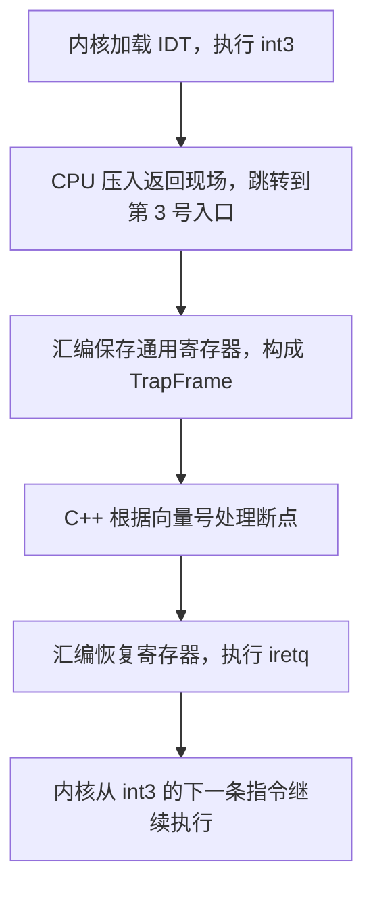

# SimpleOS Trap 功能介绍

Trap 是内核接收和处理 CPU 异常的路径。CPU 遇到异常后，把控制权交给内核的处理入口。内核保存执行现场，判断发生了什么，并在处理允许继续时恢复原来的执行。

SimpleOS 目前用 `int3` 做启动自检。`int3` 是 x86 的断点指令，执行它会触发第 3 号向量的断点异常 `#BP`。向量是 CPU 用来查找处理入口的编号。这个实验的触发时机明确，处理完可以继续执行，因此适合用来验证一次完整的异常往返。自检全程在内核态运行，期间保持可屏蔽中断关闭。 [Intel 系统编程手册，第 6 章](https://www.intel.com/content/dam/www/public/us/en/documents/manuals/64-ia-32-architectures-software-developer-vol-3a-part-1-manual.pdf)

## 从 `int3` 到恢复执行



1. **注册异常入口。** `initialize_traps()` 将 `x86_64_breakpoint_entry` 的地址写入 IDT 第 3 项，再用 `lidt` 让 CPU 知道表的位置和大小。IDT 是中断描述符表。每个表项记录该向量要跳到哪里。当前只有第 3 项已注册。 [idt.cpp](../../src/arch/x86_64/idt.cpp)
2. **保存执行现场。** 触发 `int3` 后，CPU 把返回地址、标志寄存器和原栈指针等信息压入栈。断点异常没有硬件错误码，汇编入口补一个 `0`，接着压入向量号和 15 个通用寄存器。这样，即使处理函数调用日志代码并改写了寄存器，汇编仍然能恢复原值。 [trap_entry.S](../../src/arch/x86_64/trap_entry.S) · [Intel 系统编程手册，第 6 章](https://www.intel.com/content/dam/www/public/us/en/documents/manuals/64-ia-32-architectures-software-developer-vol-3a-part-1-manual.pdf)
3. **交给 C++ 处理。** 汇编将这段栈内存的地址作为 `TrapFrame*` 传入 `trap_dispatch()`。分发函数读取 `frame->vector`，识别出第 3 号断点异常，打印 `[DEBUG] breakpoint handled` 后返回到汇编入口。 [TrapFrame](../../include/arch/x86_64/trap.hpp) · [trap.cpp](../../src/arch/x86_64/trap.cpp)
4. **恢复并返回。** 汇编弹出通用寄存器，跳过自己添加的向量号和错误码，再用 `iretq` 让 CPU 恢复其保存的返回现场。对于 `int3`，保存的指令地址 `RIP` 指向下一条指令，因此 `kernel_main()` 会接着打印 `after int3`。 [trap_entry.S](../../src/arch/x86_64/trap_entry.S) · [main.cpp](../../src/kernel/main.cpp) · [Intel 系统编程手册，第 6 章](https://www.intel.com/content/dam/www/public/us/en/documents/manuals/64-ia-32-architectures-software-developer-vol-3a-part-1-manual.pdf)

## 汇编和 C++ 如何共用现场

`TrapFrame` 描述的是栈上的字节布局。x86_64 的栈向低地址增长。汇编最后压入 `r15`，因此从栈顶往高地址读时，`r15` 就是结构体里的第一个字段。汇编按下面的布局保存数据，并在调用 C++ 前把调用栈对齐到 16 字节。 [trap_entry.S](../../src/arch/x86_64/trap_entry.S) · [TrapFrame](../../include/arch/x86_64/trap.hpp) · [AMD64 System V ABI](https://gitlab.com/x86-psABIs/x86-64-ABI/-/blob/master/x86-64-ABI/low-level-sys-info.tex)

```text
低地址  r15 … rax                      汇编保存的通用寄存器
        vector = 3, error_code = 0     汇编补充的信息
高地址  rip, cs, rflags, rsp, ss        CPU 保存的返回现场
```

## 如何验证

在项目根目录执行 `make run`。字符画之后的启动日志中应依次出现以下三行。

```text
[DEBUG] before int3
[DEBUG] breakpoint handled
[DEBUG] after int3
```

第二行说明 CPU 已进入断点处理函数，第三行说明处理完后回到了 `int3` 后面。按 `Ctrl+C` 结束 QEMU。也可以运行 `make test`，由启动测试自动检查日志顺序。 [启动测试](../../scripts/test-boot.sh) · [最小内核启动说明](最小内核启动说明.md)

## 与后续课程功能的关系

后续加入不同的入口和处理逻辑后，缺页异常可交给内存管理模块判断能否补上页面映射，时钟中断可给调度器提供抢占机会，项目计划中的 `int 0x80` 可承接用户态系统调用。这些功能都用得上本次验证的按向量找入口、保存现场和恢复执行机制。 [阶段 2 实施指南](../steps/02_Phase2_中断异常特权级与系统调用.md)
