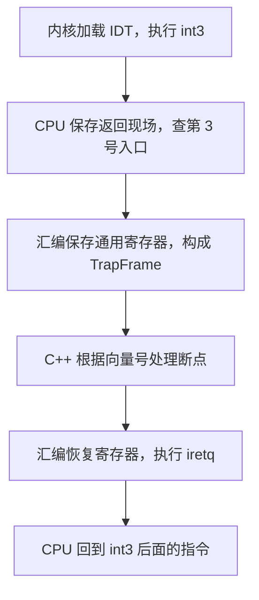

# Trap 功能介绍

Trap 路径让内核接收 CPU 异常，按照向量号选择处理函数，并在处理允许继续时恢复原来的执行。SimpleOS 目前支持第 3 号断点异常 `#BP` 和第 6 号无效指令异常 `#UD`。正常启动验证 `int3` 返回，独立测试镜像验证 `ud2` 触发诊断停机。两个自检都在内核态运行，期间保持可屏蔽中断关闭。 [Intel 系统编程手册，第 6 章](https://www.intel.com/content/dam/www/public/us/en/documents/manuals/64-ia-32-architectures-software-developer-vol-3a-part-1-manual.pdf)

## 断点异常的执行路径

1. **注册入口。** `initialize_traps()` 将 `x86_64_breakpoint_entry` 的地址写入 `idt[3]`，再用 `lidt` 告诉 CPU 表的位置和大小。IDT 是中断描述符表，CPU 用向量号查找相应的处理入口。 [idt.cpp](../../src/arch/x86_64/idt.cpp)
2. **将现场写入栈。** `int3` 触发后，CPU 压入恢复执行所需的 `RIP`、`RFLAGS`、原栈指针等信息。汇编入口补上向量号 `3` 和错误码占位值 `0`，再保存 15 个通用寄存器。汇编最后压入 `r15`，所以从栈顶往高地址看，`TrapFrame` 的第一个字段就是 `r15`。 [汇编入口](../../src/arch/x86_64/trap_entry.S) · [TrapFrame](../../include/arch/x86_64/trap.hpp)
3. **调用 C++ 处理函数。** 汇编传入 `TrapFrame*`，并对齐调用栈。`trap_dispatch()` 通过 `frame->vector` 读出向量号，识别断点后输出 `breakpoint handled`，再返回汇编入口。 [trap.cpp](../../src/arch/x86_64/trap.cpp) · [AMD64 System V ABI](https://gitlab.com/x86-psABIs/x86-64-ABI/-/blob/master/x86-64-ABI/low-level-sys-info.tex)
4. **从栈恢复现场。** 汇编弹出通用寄存器，跳过向量号和错误码，再执行 `iretq`，让 CPU 恢复返回地址和标志等信息。断点的返回地址指向 `int3` 之后，所以内核会继续打印 `after int3`。 [返回入口](../../src/arch/x86_64/trap_entry.S) · [启动自检](../../src/kernel/main.cpp)

## 无效指令为什么进入停机路径

`ud2` 专门用来触发无效指令异常。CPU 查 `IDT[6]`，汇编入口压入向量号 `6` 和错误码占位值 `0`，然后和 `int3` 共用寄存器保存流程。C++ 分发函数从 `TrapFrame` 读出向量号和 `RIP`，打印诊断后停机。 [IDT](../../src/arch/x86_64/idt.cpp) · [汇编入口](../../src/arch/x86_64/trap_entry.S) · [异常分发](../../src/arch/x86_64/trap.cpp)

`#UD` 保存的 `RIP` 指向出错的 `ud2` 本身。如果直接执行 `iretq`，CPU 会回到同一条指令，再次触发异常。日志里的 `RIP` 因此既是故障地址，也解释了这条处理路径为什么选择停机。 [Intel 指令手册，UD2](https://www.intel.com/content/dam/www/public/us/en/documents/manuals/64-ia-32-architectures-software-developer-vol-2b-manual.pdf)

## 在 QEMU 中验证

执行 `make run`，在串口输出中找到 `before int3`、`breakpoint handled`、`after int3`。中间一条表示 CPU 已进入处理函数，最后一条表示 CPU 成功恢复执行。

执行 `make test-ud` 启动测试镜像。测试入口在执行 `ud2` 前打印该指令地址。脚本检查 `[ERROR] #UD Invalid opcode (vector 6)` 日志中的 `RIP` 与地址一致，并确认 QEMU 保持运行到超时、串口只出现预期的两条日志。`make test` 包含两个 QEMU 自检。 [测试入口](../../tests/trap/ud_test.cpp) · [启动测试脚本](../../scripts/test-boot.sh) · [构建与验证指南](../guides/getting-started.md)

后续可沿用按向量查入口、在栈上保存现场、处理后恢复执行的机制，接入缺页异常、定时器中断和计划中的 `int 0x80` 系统调用。 [Trap 开发计划](../plan/trap.md)
