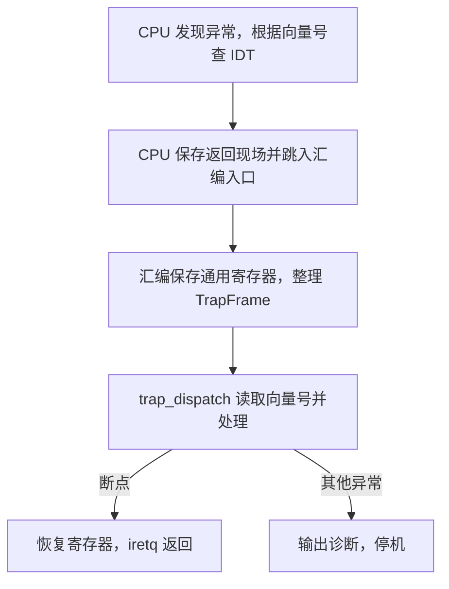

# Trap 功能介绍

Trap 模块负责内核运行时的 CPU 异常处理。CPU 发现异常后，通过中断描述符表（IDT）找到入口。内核保存执行现场，根据异常类型处理，再决定是否恢复原来的执行。SimpleOS 当前为内核态的 `0–31` 号向量安装了入口，保留向量也有诊断入口。断点 `#BP` 处理后继续执行，其余向量走诊断停机路径。

## 运行中何时会进入 Trap

执行指令、访问内存和切换段时，CPU 会检查操作是否符合规则。发现异常后，CPU 用**向量号**标识事件，并自动进入对应的处理入口。代码也可以通过 `int3` 主动触发断点。 [Intel 系统编程手册，第 6 章](https://www.intel.com/content/dam/www/public/us/en/documents/manuals/64-ia-32-architectures-software-developer-vol-3a-part-1-manual.pdf)

| 异常 | 运行中的典型触发条件 | SimpleOS 当前处理 |
| --- | --- | --- |
| `#DE`（0）除法异常 | 整数除法的除数为零，或商超出目标寄存器的范围 | 记录异常和故障指令地址，停机 |
| `#BP`（3）断点异常 | 执行软件断点指令 `int3`，例如调试器插入的断点 | 记录断点日志，从 `int3` 后继续执行 |
| `#UD`（6）无效指令 | 执行当前 CPU 或执行模式不支持的指令 | 记录故障指令地址，停机 |
| `#DF`（8）双重故障 | CPU 递送异常时又遇到无法按常规顺序处理的异常组合 | 切到应急栈，记录最小诊断后停机 |
| `#SS`（12）栈段异常 | 例如内核尝试加载标为不存在的栈段 | 记录故障指令地址和硬件错误码，停机 |
| `#GP`（13）一般保护异常 | 例如内核加载了不符合要求的段描述符 | 记录故障指令地址和硬件错误码，停机 |
| `#PF`（14）缺页异常 | 访问未映射的虚拟地址，或访问违反页权限 | 记录故障指令地址、访存地址和硬件错误码，停机 |

其他向量的名称和错误码规则见 [异常向量表](../../include/arch/x86_64/exception_vectors.inc)。

## 从异常入口到处理结果

1. **按向量找入口。** 启动时 `initialize_traps()` 安装异常门并加载 IDT。例如 CPU 触发 `#PF` 时，通过 `IDT[14]` 找到第 14 号入口。`#DF` 的门还配置了 IST（中断栈表），CPU 在保存返回现场前会切到 TSS 指定的独立应急栈。 [IDT 初始化](../../src/arch/x86_64/idt.cpp) · [GDT 和 TSS](../../src/arch/x86_64/gdt.cpp)
2. **把现场整理到栈上。** CPU 保存 `RIP`、标志寄存器和原栈指针等返回信息。汇编补上向量号并保存通用寄存器。对于 `#GP`、`#PF` 等异常，错误码来自 CPU。对于 `#BP`、`#UD` 等异常，汇编用 `0` 补齐同一个字段。 [汇编入口](../../src/arch/x86_64/trap_entry.S)
3. **按异常类型处理。** 汇编把现场地址传给 C++ 的 `trap_dispatch(TrapFrame* frame)`。`TrapFrame` 描述数据在栈上的排列，`frame->vector` 就是从这份现场读取向量号。分发函数据此选择断点返回、缺页诊断、双重故障诊断或通用诊断。 [TrapFrame](../../include/arch/x86_64/trap.hpp) · [C++ 分发](../../src/arch/x86_64/trap.cpp)
4. **恢复执行或停机。** 断点处理返回后，汇编恢复通用寄存器，再用 `iretq` 让 CPU 恢复返回现场。`#BP` 保存的 `RIP` 指向 `int3` 后面。`#UD` 和 `#PF` 保存的 `RIP` 指向故障指令，故障原因仍存在时，返回后会再次触发同一异常。 [汇编返回路径](../../src/arch/x86_64/trap_entry.S) · [Intel 系统编程手册，第 6 章](https://www.intel.com/content/dam/www/public/us/en/documents/manuals/64-ia-32-architectures-software-developer-vol-3a-part-1-manual.pdf)

## 如何读异常诊断

- **向量号**说明发生了哪一种异常。
- **`RIP`** 是 CPU 保存的指令地址。排查 `#UD`、`#GP`、`#PF` 时，可以用它定位触发故障的指令。
- **`error_code`** 提供进一步的原因，含义由异常类型决定。比如 `#PF` 的错误码可帮助区分页面不存在与权限违规。`#GP` 或 `#PF` 的硬件错误码也可能为 `0`。
- **`CR2`** 记录触发 `#PF` 的访存地址。例如 `RIP` 能定位某条读内存的指令，`CR2` 告诉你那条指令试图读哪个虚拟地址。处理函数在打印日志前先读取它。 [Intel 系统编程手册，第 4、6 章](https://www.intel.com/content/dam/www/public/us/en/documents/manuals/64-ia-32-architectures-software-developer-vol-3a-part-1-manual.pdf)
- **`IST=yes`** 表示 `#DF` 的 `TrapFrame` 位于预留的应急栈中。 [异常诊断实现](../../src/arch/x86_64/trap.cpp)

## Ring 3 的描述符与内核入口栈

GDT 的第 5、6 项是 Ring 3 的代码段和可写数据段，对应选择子 `0x2b` 和 `0x33`。选择子高位给出表项索引，低两位的 `3` 表示请求的特权级。等实现 `enter_user_mode()` 时，这两个选择子将分别用于返回现场的 `CS` 和 `SS`。 [段选择子](../../include/arch/x86_64/segments.h) · [GDT 初始化](../../src/arch/x86_64/gdt.cpp)

`initialize_segments()` 将独立的 16 KiB 内核入口栈的顶部地址写入 `tss.rsp[0]`。将来普通异常门或系统调用门把 Ring 3 切入 Ring 0 时，CPU 可从这个 `RSP0` 得到内核栈顶，再把用户态返回现场压到栈上。`#DF` 继续从 `IST[1]` 取得自己的应急栈。GDT 和 TSS 分别通过 `lgdt` 和 `ltr` 加载。 [GDT 与栈配置](../../src/arch/x86_64/gdt.cpp) · [描述符加载汇编](../../src/arch/x86_64/gdt_load.S) · [Intel 系统编程手册](https://www.intel.com/content/dam/www/public/us/en/documents/manuals/64-ia-32-architectures-software-developer-vol-3a-part-1-manual.pdf)

缺页恢复、首次进入 Ring 3、系统调用和设备 IRQ 的后续工作记录在 [Trap 开发计划](../plan/trap.md)。QEMU 自检命令和日志位置见 [构建、运行与验证](../guides/getting-started.md)。
