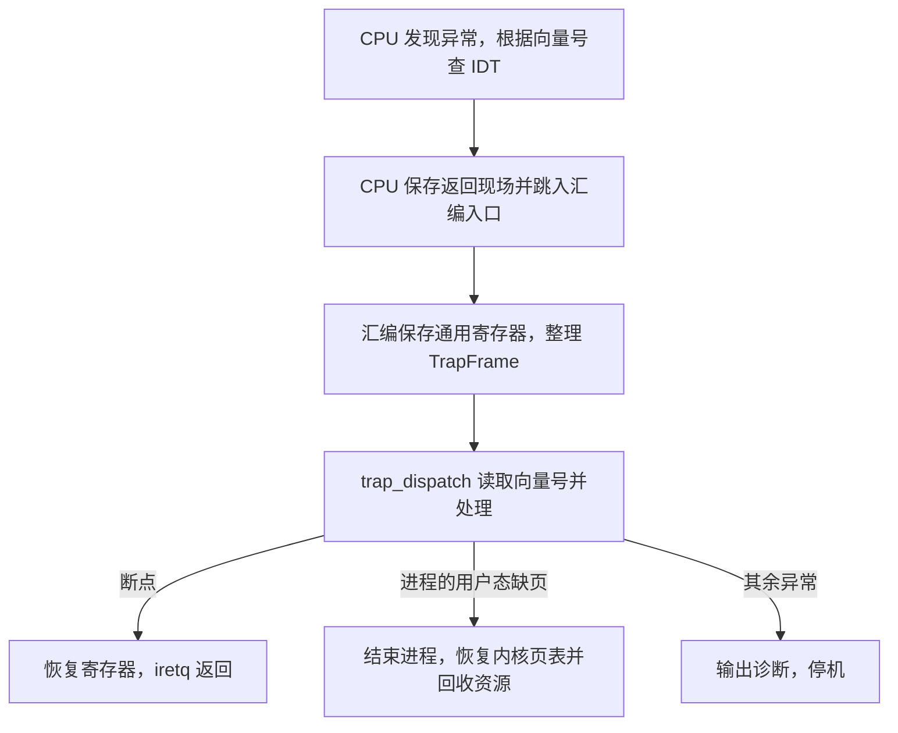

# Trap 功能介绍

Trap 模块处理 CPU 异常和系统调用。CPU 通过中断描述符表（IDT）找到入口，内核保存执行现场，再分发给对应的处理函数。SimpleOS 为 `0–31` 号异常向量安装了指向 Ring 0 的入口，保留向量也有诊断入口。断点 `#BP` 处理后继续执行。`run_process()` 启动的用户程序发生 `#PF` 时，内核结束进程并回收地址空间。用户程序通过 `int 0x80` 请求内核输出、申请或释放内存、结束执行。

## 运行中何时会进入 Trap

执行指令、访问内存和切换段时，CPU 会检查操作是否符合规则。发现异常后，CPU 用**向量号**标识事件，并自动进入对应的处理入口。代码也可以通过 `int3` 主动触发断点。 [Intel 系统编程手册，第 6 章](https://www.intel.com/content/dam/www/public/us/en/documents/manuals/64-ia-32-architectures-software-developer-vol-3a-part-1-manual.pdf)

| 异常 | 运行中的典型触发条件 | SimpleOS 当前处理 |
| --- | --- | --- |
| `#DE`（0）除法异常 | 整数除法的除数为零，或商超出目标寄存器的范围 | 记录异常和故障指令地址，停机 |
| `#BP`（3）断点异常 | 执行软件断点指令 `int3`，例如调试器插入的断点 | 记录断点日志，从 `int3` 后继续执行 |
| `#UD`（6）无效指令 | 执行当前 CPU 或执行模式不支持的指令 | 记录故障指令地址，停机 |
| `#DF`（8）双重故障 | CPU 递送异常时又遇到无法按常规顺序处理的异常组合 | 切到应急栈，记录最小诊断后停机 |
| `#SS`（12）栈段异常 | 例如内核尝试加载标为不存在的栈段 | 记录故障指令地址和硬件错误码，停机 |
| `#GP`（13）一般保护异常 | 例如内核加载了不符合要求的段描述符 | 记录故障指令地址和硬件错误码，停机 |
| `#PF`（14）缺页异常 | 访问未映射的虚拟地址，或访问违反页权限 | `run_process()` 启动的用户程序缺页时，打印访存地址并结束进程。内核缺页时记录故障指令地址、访存地址和硬件错误码后停机。 |

其他向量的名称和错误码规则见 [异常向量表](../../include/arch/x86_64/exception_vectors.inc)。

## 从异常入口到处理结果

1. **按向量找入口。** 启动时 `initialize_traps()` 安装异常门并加载 IDT。例如 CPU 触发 `#PF` 时，通过 `IDT[14]` 找到第 14 号入口。`#DF` 的门还配置了 IST（中断栈表），CPU 在保存返回现场前会切到 TSS 指定的独立应急栈。 [IDT 初始化](../../src/arch/x86_64/idt.cpp) · [GDT 和 TSS](../../src/arch/x86_64/gdt.cpp)
2. **把现场整理到栈上。** CPU 保存 `RIP`、标志寄存器和原栈指针等返回信息。汇编补上向量号并保存通用寄存器。对于 `#GP`、`#PF` 等异常，错误码来自 CPU。对于 `#BP`、`#UD` 等异常，汇编用 `0` 补齐同一个字段。 [汇编入口](../../src/arch/x86_64/trap_entry.S)
3. **按异常类型处理。** 汇编把现场地址传给 C++ 的 `trap_dispatch(TrapFrame* frame)`。`TrapFrame` 描述数据在栈上的排列，`frame->vector` 就是从这份现场读取向量号。分发函数据此选择断点返回、缺页诊断、双重故障诊断或通用诊断。 [TrapFrame](../../include/arch/x86_64/trap.hpp) · [C++ 分发](../../src/arch/x86_64/trap.cpp)
4. **恢复执行、结束进程或停机。** 断点处理返回后，汇编恢复通用寄存器，再用 `iretq` 让 CPU 从 `int3` 后面继续。`#UD` 和 `#PF` 保存的 `RIP` 指向故障指令，故障原因仍存在时，返回后会再次触发同一异常。`run_process()` 启动的用户程序发生缺页后，处理函数调用 `task::exit_current(-14)`，回到内核的进程启动流程。内核缺页仍进入诊断停机。 [汇编返回路径](../../src/arch/x86_64/trap_entry.S) · [缺页处理](../../src/arch/x86_64/trap.cpp) · [Intel 系统编程手册，第 6 章](https://www.intel.com/content/dam/www/public/us/en/documents/manuals/64-ia-32-architectures-software-developer-vol-3a-part-1-manual.pdf)

## 如何读异常诊断

- **向量号**说明发生了哪一种异常。
- **`RIP`** 是 CPU 保存的指令地址。排查 `#UD`、`#GP`、`#PF` 时，可以用它定位触发故障的指令。
- **`error_code`** 提供进一步的原因，含义由异常类型决定。比如 `#PF` 的错误码可帮助区分页面不存在与权限违规。`#GP` 或 `#PF` 的硬件错误码也可能为 `0`。
- **`CR2`** 记录触发 `#PF` 的访存地址。例如 `RIP` 能定位某条读内存的指令，`CR2` 告诉你那条指令试图读哪个虚拟地址。处理函数在打印日志前先读取它。 [Intel 系统编程手册，第 4、6 章](https://www.intel.com/content/dam/www/public/us/en/documents/manuals/64-ia-32-architectures-software-developer-vol-3a-part-1-manual.pdf)
- **`IST=yes`** 表示 `#DF` 的 `TrapFrame` 位于预留的应急栈中。 [异常诊断实现](../../src/arch/x86_64/trap.cpp)

## Ring 3 的描述符与内核入口栈

GDT 的第 5、6 项是 Ring 3 的代码段和可写数据段，对应选择子 `0x2b` 和 `0x33`。选择子高位给出表项索引，低两位的 `3` 表示请求的特权级。`enter_user_mode()` 分别将这两个选择子用作返回现场的 `CS` 和 `SS`，再加入用户入口地址、用户栈顶和 `RFLAGS`。CPU 通过 `iretq` 读取这些值，从指定地址开始以 Ring 3 权限执行。此时 `IF=0`，可屏蔽中断保持关闭。 [段选择子](../../include/arch/x86_64/segments.h) · [用户态入口汇编](../../src/arch/x86_64/enter_user_mode.S)

`initialize_segments()` 将独立的 16 KiB 内核入口栈的顶部地址写入 `tss.rsp[0]`。用户态异常通过普通异常门切到 Ring 0 时，CPU 从这个 `RSP0` 得到内核栈顶，再把用户态返回现场压到栈上。`#DF` 则使用第一个 IST 表项指定的应急栈。GDT 和 TSS 分别通过 `lgdt` 和 `ltr` 加载。 [GDT 与栈配置](../../src/arch/x86_64/gdt.cpp) · [描述符加载汇编](../../src/arch/x86_64/gdt_load.S) · [Intel 系统编程手册，第 6 章](https://www.intel.com/content/dam/www/public/us/en/documents/manuals/64-ia-32-architectures-software-developer-vol-3a-part-1-manual.pdf)

`make test-ring3` 在独立镜像中动态申请并映射两张 4 KiB 用户页。代码页从 `0x400000` 起，可读、可执行。栈页从 `0x401000` 起，可读写，开启 NX 时禁止执行。用户代码先用 `pushq` 写入自己的栈，再用 `ud2` 触发 CPU 异常。`#UD` 由 CPU 递送，因此使用现有的异常门。 [Ring 3 自检源码](../../tests/trap/ring3_test.cpp) · [动态用户页映射](user-paging.md)

日志中的 `CS=0x2b` 和 `SS=0x33` 来自 CPU 保存的用户现场，`RSP=0x401ff8` 对应完成一次 8 字节压栈后的用户栈顶。`on RSP0 stack=yes` 表示整份 `TrapFrame` 位于当前的 16 KiB 内核入口栈内。之后按 `#UD` 的现有诊断流程停机。 [异常诊断实现](../../src/arch/x86_64/trap.cpp) · [构建、运行与验证](../guides/getting-started.md)

## 用户程序怎样调用内核

IDT 的 `0x80` 号门设置为 `DPL=3`，允许用户程序执行 `int 0x80`。门的目标是内核代码段，CPU 使用 `RSP0` 换栈。汇编入口沿用异常的现场布局，再由 `trap_dispatch()` 把 `TrapFrame` 交给系统调用分发器。 [IDT 初始化](../../src/arch/x86_64/idt.cpp) · [汇编入口](../../src/arch/x86_64/trap_entry.S) · [Intel 系统编程手册，第 6 章](https://www.intel.com/content/dam/www/public/us/en/documents/manuals/64-ia-32-architectures-software-developer-vol-3a-part-1-manual.pdf)

| 调用 | `RAX` 调用号 | 参数 | 结果 |
| --- | --- | --- | --- |
| `sys_write(fd, buffer, size)` | `1` | `RDI` 是输出目标，`RSI` 是用户地址，`RDX` 是字节数。首版 `fd=1` 对应 COM1。 | 返回 `RAX` 中的字节数或负错误码。 |
| `sys_exit(status)` | `2` | `RDI` 的低 32 位是退出状态。 | 结束用户执行，由内核取得退出状态。 |
| `sys_alloc(bytes)` | `3` | `RDI` 是申请的字节数。 | `RAX` 返回页对齐的用户地址或负错误码。用户态封装在失败时返回 `nullptr`。 |
| `sys_free(address)` | `4` | `RDI` 是申请返回的区间起点。 | `RAX` 返回 `0` 或负错误码。 |

`sys_write` 先检查长度和地址范围，再沿当前页表确认每一页都允许用户访问。发送由串口驱动按字节完成，保留百分号、零字节和原始换行。分发器把结果写进 `TrapFrame::rax`，汇编恢复 `RAX` 后执行 `iretq`，用户程序从 `int 0x80` 后继续。对于有效输出目标，零长度写入返回 `0`。无效输出目标返回 `-9`，无效用户缓冲区返回 `-14`，长度超出返回值范围时返回 `-22`，未知调用号返回 `-38`。 [调用约定](../../include/abi/syscall.hpp) · [用户态封装](../../src/user/syscall.cpp) · [内核分发](../../src/kernel/syscall.cpp) · [页表校验](../../src/arch/x86_64/paging.cpp)

`task::run_process()` 保存原 `CR3`，切进进程页表，再把本次运行的 `UserReturnContext` 传给 `run_user_mode()` 并进入 Ring 3。汇编把调用约定要求保留的寄存器压到原内核栈，并把栈指针写入传入的现场。`sys_exit` 和用户态缺页都通过 `task::exit_current()` 找回这份现场，让汇编从原内核栈继续。回到 `run_process()` 后，先恢复原 `CR3`，再释放进程的用户页和页表，最后交回退出状态。 [进程启动与退出](../../src/task/process.cpp) · [用户态进入与退出](../../src/arch/x86_64/enter_user_mode.S) · [回收验证](../../tests/trap/syscall_test.cpp)
