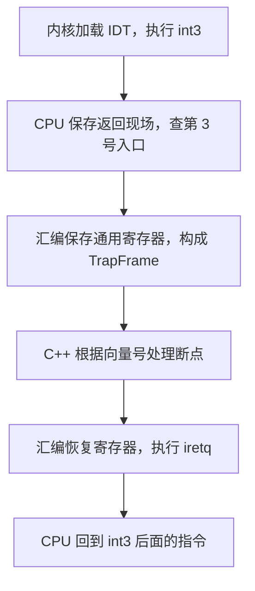

# Trap 功能介绍

Trap 路径让内核接收 CPU 异常，按照向量号选择处理函数，并在处理允许继续时恢复原来的执行。SimpleOS 当前注册了第 3 号向量。启动时在内核态执行 `int3`，用一次可控的断点异常 `#BP` 验证进入、处理和返回。自检期间保持可屏蔽中断关闭。 [Intel 系统编程手册，第 6 章](https://www.intel.com/content/dam/www/public/us/en/documents/manuals/64-ia-32-architectures-software-developer-vol-3a-part-1-manual.pdf)

## 断点异常的执行路径

1. **注册入口。** `initialize_traps()` 将 `x86_64_breakpoint_entry` 的地址写入 `idt[3]`，再用 `lidt` 告诉 CPU 表的位置和大小。IDT 是中断描述符表，CPU 用向量号查找相应的处理入口。 [idt.cpp](../../src/arch/x86_64/idt.cpp)
2. **将现场写入栈。** `int3` 触发后，CPU 压入恢复执行所需的 `RIP`、`RFLAGS`、原栈指针等信息。汇编入口补上向量号 `3` 和错误码占位值 `0`，再保存 15 个通用寄存器。汇编最后压入 `r15`，所以从栈顶往高地址看，`TrapFrame` 的第一个字段就是 `r15`。 [汇编入口](../../src/arch/x86_64/trap_entry.S) · [TrapFrame](../../include/arch/x86_64/trap.hpp)
3. **调用 C++ 处理函数。** 汇编传入 `TrapFrame*`，并对齐调用栈。`trap_dispatch()` 通过 `frame->vector` 读出向量号，识别断点后输出 `breakpoint handled`，再返回汇编入口。 [trap.cpp](../../src/arch/x86_64/trap.cpp) · [AMD64 System V ABI](https://gitlab.com/x86-psABIs/x86-64-ABI/-/blob/master/x86-64-ABI/low-level-sys-info.tex)
4. **从栈恢复现场。** 汇编弹出通用寄存器，跳过向量号和错误码，再执行 `iretq`，让 CPU 恢复返回地址和标志等信息。断点的返回地址指向 `int3` 之后，所以内核会继续打印 `after int3`。 [返回入口](../../src/arch/x86_64/trap_entry.S) · [启动自检](../../src/kernel/main.cpp)

## 用启动日志验证

执行 `make run`，在串口输出中找到 `before int3`、`breakpoint handled`、`after int3`。中间一条表示 CPU 已进入处理函数，最后一条表示 CPU 成功恢复执行。`make test` 会在 QEMU 中检查这三条日志的顺序。 [构建与验证指南](../guides/getting-started.md)

后续可沿用按向量查入口、在栈上保存现场、处理后恢复执行的机制，接入缺页异常、定时器中断和计划中的 `int 0x80` 系统调用。 [开发路线](../development/roadmap.md)
