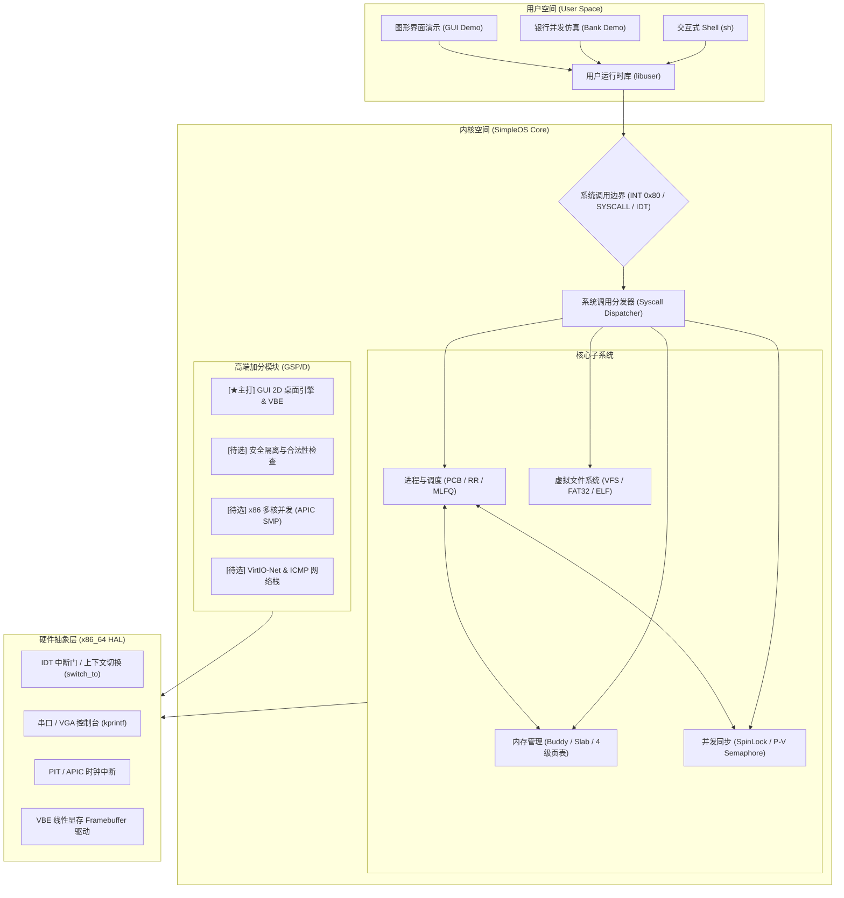
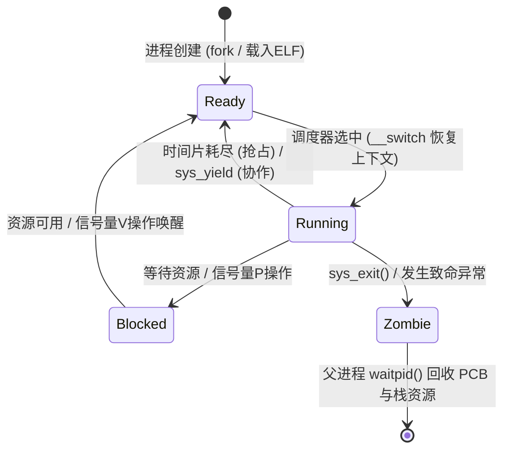
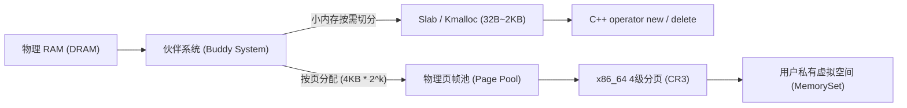

# SimpleOS 架构设计文档 (精简速查版)

---

## 1. 核心架构图解 (Mermaid 视图)

### 1.1 系统分层拓扑架构


---

### 1.2 进程生命周期与调度状态机


---

### 1.3 内存分配与管理流水线


---

## 2. 核心模块与核心类速查

| 模块名称 | 核心 C++ 类 / 文件 | 关键职责与核心 API |
| :--- | :--- | :--- |
| **HAL 抽象** | `TrapContext`, `TaskContext`, `arch/x86_64/` | `switch_to(curr, next)`: Callee-saved 寄存器切换<br>`idt_dispatch(ctx)`: 中断与系统调用分发 |
| **基础运行库** | `KString`, `KVector`, `IntrusiveList` | 无宿主 C++ 基础设施，重载全局 `new/delete`，提供零拷贝侵入式就绪链表 |
| **内存管理** | `BuddyAllocator`, `SlabCache`, `PageTable` | `kmalloc(size)` / `kfree(ptr)`: 内核动态堆<br>`map(va, pa, flags)`: 虚拟地址映射与特权位控制 |
| **进程调度** | `Process`, `Scheduler`, `MLFQ` | `spawn(elf)`: 动态载入进程<br>`yield()`: 主动让渡 CPU<br>`schedule()`: 轮转或多级队列选路 |
| **同步互斥** | `SpinLock`, `Semaphore`, `BankAccount` | `sem.wait()` (P 操作): 计数递减与阻塞入队<br>`sem.signal()` (V 操作): 计数递增与唤醒等待线程 |
| **文件系统** | `VFS`, `Fat32FileSystem`, `ElfLoader` | `read_file(path)`: 读取磁盘/内存镜像<br>`load_elf(data)`: 解析 ELF64 Header 与段映射 |

---

## 3. 经典银行存取款并发测试架构 (阶段 5 核心)

```
[并发测试发起器: 10 个线程]
      │
      ├───────────────────────────────┬───────────────────────────────┐
      ▼                                                               ▼
【测试 A：无锁竞态场景 (Unsafe)】                               【测试 B：P-V 信号量保护场景 (Safe)】
for (1..1000):                                                for (1..1000):
    val = balance;                                                sem.wait(); // P 原语
    val += 10;                                                    balance += 10;
    // 时钟中断切走 -> 丢失修改!                                  balance -= 10;
    val -= 10;                                                    sem.signal(); // V 原语
    balance = val;                                            
[最终账目]: 严重不平衡 (差额随机，暴露BUG)                     [最终账目]: 初始值 == 最终值 (100% 绝对平衡)
```

---

## 4. 高端加分项架构速览 (重点主打 GUI)

```
┌────────────────────────────────────────────────────────────────────────┐
│                        高端加分四大支柱 (GSP/D)                        │
├──────────────────┬──────────────────┬──────────────────┬───────────────┤
│ 【★主打】GUI 引擎 │  [待选] 安全隔离 │  [待选] SMP 多核 │  [待选] 网络栈│
├──────────────────┼──────────────────┼──────────────────┼───────────────┤
│ • VBE 显存驱动   │ • MMU 页表 U/S 位│ • LAPIC 多核启动 │ • VirtIO-Net  │
│ • 双缓冲杜绝撕裂 │ • copy_from_user │ • Per-CPU 私有栈 │ • ARP 请求响应│
│ • 8x16 点阵字库  │   合法指针边界校验│ • 多核调度自旋锁 │ • ICMP 回显   │
│ • 动态桌面与图表 │ • 栈底 Canary 哨兵│ • 核间中断 IPI   │   (Ping 通测试)│
└──────────────────┴──────────────────┴──────────────────┴───────────────┘
```
