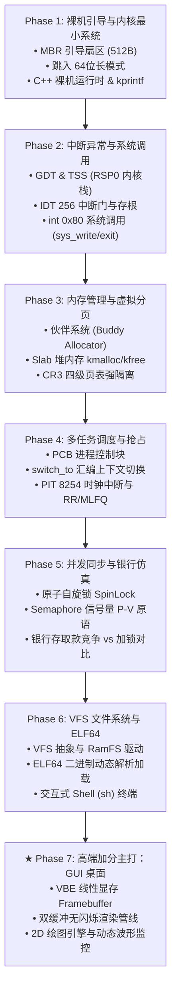

# SimpleOS 项目实施步骤文档 (精简速查版)

---

## 1. 实施阶段全景路线 (Mermaid 路线图)



---

## 2. 里程碑实施与产物速查表

| 阶段 / 周期 | 核心开发任务 | 核心源文件产物 | 验收与测试命令 |
| :--- | :--- | :--- | :--- |
| **Phase 1: 裸机与内核** | 1. 编写 512B MBR 引导代码<br>2. 开启 A20 与 64 位长模式<br>3. 链接脚本与裸机 `kprintf` | `arch/x86_64/boot.S`<br>`kernel/kprintf.cpp`<br>`linker.ld`, `Makefile` | `make build`<br>`make run` (显示启动 Banner) |
| **Phase 2: 特权与中断** | 1. 初始化 GDT 与 TSS (RSP0)<br>2. 构建 IDT 256 个中断门存根<br>3. 实现 `int 0x80` 系统调用 | `arch/x86_64/idt.cpp`<br>`kernel/syscall.cpp`<br>`user/hello.cpp` | `make run` 观察用户程序通过系统调用输出并安全退出 |
| **Phase 3: 内存与分页** | 1. 伙伴系统物理页分配<br>2. Slab 小对象堆缓存 (`kmalloc`)<br>3. CR3 四级页表与地址空间隔离 | `mm/buddy.cpp`<br>`mm/slab.cpp`<br>`mm/pagetable.cpp` | 运行 `mem_test`，验证 `new/delete` 及内核空间防非法越界保护 |
| **Phase 4: 任务与调度** | 1. PCB 控制块与生命周期维护<br>2. 寄存器级 `switch_to` 切换<br>3. PIT 时钟中断抢占式轮转 | `task/process.cpp`<br>`arch/x86_64/switch.S`<br>`task/scheduler.cpp` | 运行 `sched_demo`，验证多个独立任务分时抢占交替输出 |
| **Phase 5: 同步与仿真** | 1. 硬件原子自旋锁 `SpinLock`<br>2. 睡眠等待信号量 `Semaphore`<br>3. 银行存取款并发测试程序 | `sync/spinlock.cpp`<br>`sync/semaphore.cpp`<br>`apps/bank_demo.cpp` | 运行 `bank_test`，直观输出未加锁的数据错乱与加锁后绝对平衡 |
| **Phase 6: 文件与ELF** | 1. VFS 虚拟文件系统抽象<br>2. ELF64 头解析与动态加载<br>3. 交互式命令行 Shell 终端 | `fs/vfs.cpp`, `fs/ramfs.cpp`<br>`loader/elf.cpp`<br>`user/sh.cpp` | 在 Shell 中输入 `ls`，执行外部独立编译的 ELF 二进制程序 |
| **★ Phase 7: GUI 桌面** | 1. VBE 1024×768 显存驱动<br>2. 双缓冲管线与 Bresenham 2D 库<br>3. 动态性能监视器桌面 Demo | `drivers/vbe.cpp`<br>`gui/canvas.cpp`<br>`gui/desktop.cpp` | 终端输入 `gui`，瞬间弹出 1024×768 高清双缓冲图形桌面与折线波形 |

---

## 3. 答辩验收与现场演示一键指南 (Cheat Sheet)

```bash
# 1. 编译并启动操作系统 (进入交互式 Shell)
make run

# 2. 现场验证系统调用与内存管理 (阶段 2 & 3)
SimpleOS# mem_test
[OK] Buddy Allocator: 32MB physical pages allocated/freed correctly.
[OK] Slab Allocator: kmalloc 128B object dynamically verified.

# 3. 现场验证多任务分时抢占调度 (阶段 4)
SimpleOS# sched_demo
[Task A] Count: 1, TimeSlice: 10ms
[Task B] Count: 1, TimeSlice: 10ms
[Task C] Count: 1, TimeSlice: 10ms ... (任务交替抢占执行正常)

# 4. 现场验证并发同步与银行存取款仿真 (阶段 5 核心)
SimpleOS# bank_test
--- Mode A: Unsafe Concurrency (No Locks) ---
Initial Balance: 10000 | Expected: 10000 | Final Balance: 7420 (RACE CONDITION DETECTED!)
--- Mode B: Safe Concurrency (P-V Semaphore) ---
Initial Balance: 10000 | Expected: 10000 | Final Balance: 10000 (100% BALANCED & SAFE!)

# 5. 现场验证文件系统与 ELF 二进制加载 (阶段 6)
SimpleOS# ls
-rwxr-xr-x  1 root  4096  hello.elf
-rwxr-xr-x  1 root  8192  gui_app.elf
SimpleOS# ./hello.elf
[ELF Loader] Loading PT_LOAD segments to user space...
Hello, World from an external ELF binary!

# 6. ★ 现场展示高端加分项：震撼弹出 GUI 桌面 (阶段 7 满分项)
SimpleOS# gui
[GUI] Switching to VBE 1024x768x32bpp Linear Framebuffer...
(QEMU 窗口实时展示带磨砂状态栏、CPU实时折线波形与时钟的图形桌面)
```
